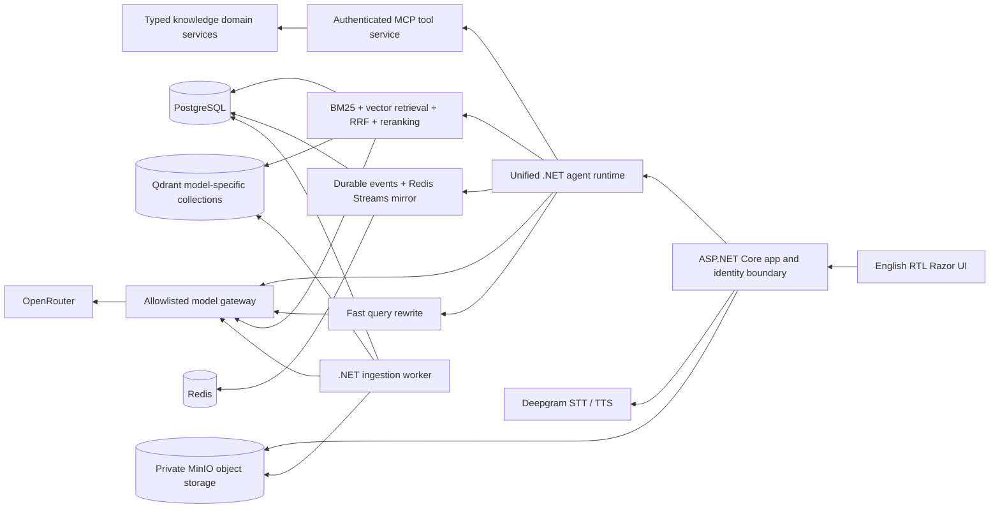
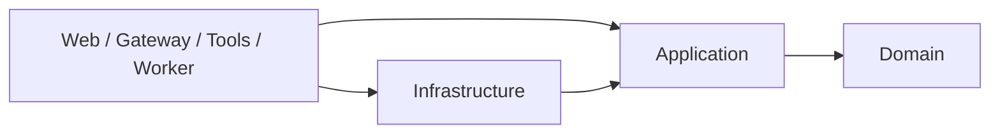
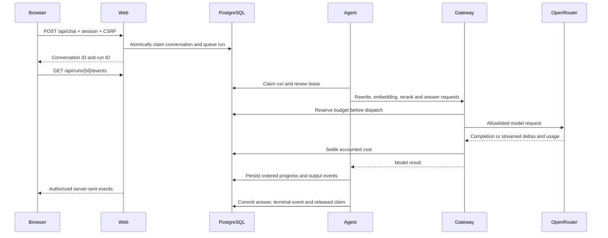

# AtlasHub

[](https://github.com/mohammadrezaabp/AtlasHub/actions/workflows/ci.yml)

A private organization knowledge workspace built with **.NET 10**, **ASP.NET Core**, **Razor Components**, **Entity Framework Core**, **PostgreSQL**, **Redis**, **Qdrant**, and **MinIO**. Atlas turns permitted documents into searchable knowledge and gives grounded, streamed AI answers with source passages. The interface is English, with RTL document support and a left navigation sidebar.

The repository contains the application, infrastructure definitions, tests and documentation. Documents, recordings, credentials, database exports and local runtime data stay outside Git.

## Contents

- [Run with Docker](#run-with-docker)
- [Configuration](#configuration)
- [Use the workspace](#use-the-workspace)
- [Model roles and cost controls](#model-roles-and-cost-controls)
- [Architecture](#architecture)
- [Realtime synchronization](#realtime-synchronization)
- [Authentication and security](#authentication-and-security)
- [Observability](#observability)
- [Build and test](#build-and-test)
- [Contributing safely](#contributing-safely)
- [Operational limits](#operational-limits)

## Run with Docker

Prerequisites: Docker Desktop using Linux containers and approximately 4 GB of available memory. Building on your computer also requires the .NET 10 SDK; running the containers does not require a system-wide SDK.

1. Clone the repository and enter its folder:

   ```sh
   git clone https://github.com/mohammadrezaabp/AtlasHub.git
   cd AtlasHub
   ```

2. Copy `.env.example` to `.env` if a local configuration does not already exist.
3. Set `OPENROUTER_API_KEY`, `DEEPGRAM_API_KEY`, strong `POSTGRES_PASSWORD` and `MINIO_ROOT_PASSWORD` values, random `INTERNAL_TOKEN` and `METRICS_TOKEN` values of at least 32 characters each, and an `ADMIN_PASSWORD` of at least 12 characters. Replace every credential placeholder. Never commit `.env`.
4. Put documents you want imported automatically into `knowledge/`, or upload them after signing in. Supported formats: `.md`, `.txt`, `.csv`, `.pdf`, `.png`, `.jpg`, `.jpeg`, and `.webp`. Files are copied into persistent storage and deduplicated by content hash. The Git repository intentionally contains no seed documents.
5. Start the workspace:

```powershell
./scripts/Start-Hub.ps1
```

Or use `docker compose up -d --build`. Open **[http://localhost:5080](http://localhost:5080)** and sign in with `ADMIN_EMAIL` and `ADMIN_PASSWORD` from your local `.env`. The first startup creates the administrator account. Changing bootstrap values later does not overwrite an existing account; use **My account** to change your password.

If the .NET SDK is available locally, `./scripts/Start-Hub.ps1 -Prebuilt` publishes the C# services on your computer and packages them in the same Docker runtime. This avoids downloading the larger SDK container image. Both modes run the application services in Docker with the same database and storage volumes.

The project uses upstream images: PostgreSQL is `postgres:16-alpine`, Redis is `redis:7.4-alpine`, Qdrant is `qdrant/qdrant:v1.15.4`, and MinIO is `quay.io/minio/minio:RELEASE.2025-09-07T16-13-09Z`. Docker reuses locally available matching images. The app and the authenticated MinIO console bind only to loopback. Database, cache, vector store, object API, gateway and tool ports stay on the internal Docker network. The console is available at [http://localhost:19001](http://localhost:19001), using `MINIO_ROOT_USER` and `MINIO_ROOT_PASSWORD`. Set `MINIO_IMAGE` to select another compatible upstream MinIO image and `MINIO_CONSOLE_PORT` to change the console port.

Stop the stack with `./scripts/Stop-Hub.ps1`. Persistent volumes retain documents, database rows, Redis events, vectors and authentication keys. Avoid deleting volumes unless you intend to erase workspace data.

### Configuration

| Variable | Required / default | Responsibility |
|---|---|---|
| `ADMIN_EMAIL`, `ADMIN_PASSWORD` | Required at first startup | Initial administrator; minimum 12-character password |
| `POSTGRES_PASSWORD` | Required | Dedicated application database credential |
| `MINIO_ROOT_USER`, `MINIO_ROOT_PASSWORD` | User defaults to `atlas-local`; password required | Private object store credentials |
| `INTERNAL_TOKEN` | Required; at least 32 random characters | Server-to-server gateway and MCP authentication |
| `METRICS_TOKEN` | Required for `/metrics`; at least 32 random characters, different from `INTERNAL_TOKEN` | Bearer token Prometheus sends when scraping |
| `OPENROUTER_API_KEY` | Required for model features | Chat, rewrite, reranking, vision and embeddings |
| `DEEPGRAM_API_KEY` | Required for speech features | Speech transcription and synthesis |
| `CHAT_MODEL`, `FAST_MODEL`, `RERANK_MODEL`, `VISION_MODEL`, `EMBEDDING_MODEL`, `FALLBACK_MODEL` | Defaults listed below | Explicit per-role model selection |
| `DAILY_BUDGET_USD`, `MAX_REQUEST_USD` | `1.00`, `0.05` | OpenRouter cost admission limits |
| `HUB_PORT` | `5080` | Loopback application port |
| `MINIO_CONSOLE_PORT` | `19001` | Loopback storage console port |
| `MINIO_IMAGE` | Pinned tag in `.env.example` | Select a compatible upstream MinIO image |
| `OTEL_EXPORTER_OTLP_ENDPOINT` | Empty | Optional collector endpoint; requires observability profile |

Compose maps these values into .NET hierarchical settings such as `Models__Chat` and `Storage__SecretKey`. Secrets are runtime environment values, not Docker build arguments. The Docker build context excludes local credentials and data. After editing configuration, recreate containers with `docker compose up -d --build`.

## Use the workspace

Atlas uses one workspace with Night and Light modes. **Home** opens AI chat. The left rail contains **Overview**, **Knowledge library**, **Search knowledge**, and, for administrators only, **Approvals**, **System & models**, and **Team management**. The account icon at the bottom opens **My account**, the theme switch, and **Sign out**. Conversation history remains in the adjacent sidebar on every page. Collapse the sidebar for more space; the sidebar button in the header reopens it. Chat and sources have independent scrolling. Older saved management links continue to work within the same interface.

- **Overview:** document counts, searchable passages, usage and recent knowledge.
- **Knowledge library:** browse team folders, then Organization, Team, or Private access folders. Upload, preview and download sources. Reindex a document after changing the embedding model or resolving a provider issue.
- **Ask Atlas:** ask questions, follow citations, continue conversations, attach images, dictate questions and listen to answers. Voice transcription is editable and is never automatically submitted.
- **Your chats:** search saved conversations, browse date groups, rename chats, or delete a conversation after confirmation. Active answers must be stopped before their conversation can be deleted. Chat messages and the compact source panel have independent scroll areas.
- **Pinned chats:** choose **Pin chat** from a conversation's menu to keep it at the top of the history. Pins are saved to your account and can be removed with **Unpin chat**.
- **Appearance:** switch between **Light mode** and **Night mode** from the account menu. Your choice is remembered in this browser.
- **Search knowledge:** hybrid keyword/semantic retrieval with model-based reranking.
- **Approvals (administrators only):** review document deletion requests from all team members. Members can propose deletion of their own documents but cannot approve requests. The API enforces this restriction independently of the UI. Proposals alone never delete documents.
- **Team management:** administrators create accounts with a role and department and can disable access immediately. There is no public registration.
- **System & models:** actual service health, configured model roles and recent token/cost accounting.
- **My account:** change your password or sign out. Password changes invalidate existing sessions.

Documents can be shared with the organization, a department, or kept private to the uploader and administrators. Authorization is enforced when listing, searching, reading, downloading, running tools and using image attachments. Qdrant results are checked against authorized relational records before entering model context.

## Model roles and cost controls

| Role | Default | Purpose |
|---|---|---|
| Chat | `google/gemini-2.5-flash-lite` | Grounded answers and bounded tool selection |
| Fast / rewrite | `openai/gpt-4.1-nano` | Resolve conversational references and rewrite queries |
| Rerank | `google/gemini-2.5-flash-lite` | Independently rank retrieved passages by relevance |
| Vision | `google/gemini-2.5-flash-lite` | Image questions and image-document text extraction |
| Embedding | `openai/text-embedding-3-small` | Document and query vectors in the same space |
| Fallback | `openai/gpt-4.1-nano` | Allowlisted chat failover before output begins |
| STT | Deepgram `nova-3` | English speech transcription |
| TTS | Deepgram `aura-2-thalia-en` | English audio answers |

These are separately configured roles. The reranker uses a small instruction-following model to rank a bounded passage list; it is **not** a locally hosted cross-encoder. No GPU or model downloads are required. Change the corresponding variables in `.env`, then recreate the stack. Reindex documents when changing `EMBEDDING_MODEL`; vectors from different models are never mixed, even if dimensions match. Vision and embedding calls do not silently switch models.

The gateway checks the provider catalog and prices, grants only configured models, clamps output limits, limits concurrent calls and per-actor request rates, reserves cost before dispatch, and enforces a workspace daily OpenRouter budget. Defaults are **$1/day** and **$0.05 maximum estimated cost per request**. Cost includes ingestion, rewrite, embedding, reranking and generation. Failed provider responses release the reservation. When a connection is interrupted or usage is absent, a conservative reservation remains instead of falsely reporting a zero charge. Provider-reported costs and catalog estimates are distinguished in usage records.

The daily window is UTC. Deepgram has separate billing; its calls are size-limited and rate-limited but are not included in the OpenRouter dollar budget. Browser recordings stop after 60 seconds, transcription uploads are capped at 10 MB, and speech output is capped at 1,800 characters per request. Provider availability, credits and model prices can change.

## Architecture

AtlasHub is a modular application with domain driven design and inward dependencies. It runs as four .NET processes plus four persistent infrastructure services. PostgreSQL is the source of truth; Redis and Qdrant support delivery and retrieval. Inference is hosted by OpenRouter and Deepgram, so the local stack needs no GPU.




### Clean Architecture and source layout



Domain has no external package or project dependencies. Application defines the use cases and ports; Infrastructure implements them. Host references to Infrastructure are composition roots. Architecture tests prevent EF Core and provider SDK access from leaking into hosts or application workflows.

```text
AtlasHub.slnx
src/
  Hub.Domain/          Identity, Knowledge, Conversations, Agents, Approvals,
                       Workspace, Usage, Auditing and Common
  Hub.Application/     Feature use cases, RAG, ingestion, agent orchestration,
                       configuration and capability interfaces
  Hub.Infrastructure/  Persistence, Storage, AI, Speech, Security, Events,
                       Tools, Caching and Monitoring
  Hub.Web/             Razor shell, browser assets, feature endpoints,
                       HTTP contracts, authentication, middleware and scheduler
  Hub.Gateway/         Model proxy and HTTP streaming
  Hub.Tools/           MCP transport
  Hub.Worker/          Document ingestion scheduler
tests/Hub.Tests/       Architecture, Domain, Application, Integration and Support
infra/                 Optional telemetry and monitoring configuration
scripts/               Startup, shutdown and publication checks
docs/                  Detailed architecture and verification notes
knowledge/             Private seed mount; only .gitkeep is tracked
```

Each class, record, interface, enum and struct has its own named file. Features are grouped by business responsibility within each layer. `GlobalUsings.cs` contains imports rather than business types.

### Runtime responsibilities

| Process | Public surface | Main responsibility |
|---|---|---|
| Web | Loopback `5080` | UI, cookies, CSRF, document and voice APIs, SSE and agent scheduling |
| Gateway | Docker network only | Model allowlists, cost admission, upstream calls, streaming and failover |
| Tools | Docker network only | Authenticated typed MCP tools and identity-scoped knowledge access |
| Worker | Docker network only | Seed import, extraction, indexing, heartbeat and durable storage cleanup |
| PostgreSQL | Docker network only | Accounts, ACL metadata, passages, conversations, jobs, events, approvals and usage |
| Redis | Docker network only | Event mirror, change notifications and short-lived authorized projection cache |
| Qdrant | Docker network only | Collections separated by embedding space |
| MinIO | Object API private; console on loopback `19001` | Original documents, recordings and synthesized speech |

The four hosts share the relational database in this deployment. They are independently runnable processes, rather than independently owned databases or an enterprise microservice topology.

### File and voice storage

Docker mode uses a private MinIO bucket named `atlas-hub`. The backend brokers every download after checking database permissions; object keys and credentials are never sent to the browser, and objects are not public. The existing team field (`Department` in the data model) controls folder names without changing access checks. Team names are sanitized and include a short hash to avoid folder collisions.

```text
teams/<team-name-hash>/documents/organization/<document-id>/<filename>
teams/<team-name-hash>/documents/team/<document-id>/<filename>
teams/<team-name-hash>/documents/private/<owner-id>/<document-id>/<filename>
teams/<team-name-hash>/voices/private/<owner-id>/recordings/<audio-id>.webm
teams/<team-name-hash>/voices/private/<owner-id>/speech/<audio-id>.mp3
```

Original recordings and generated speech are persisted with owner, team and optional conversation metadata. Voice playback uses authenticated `/api/voices/{id}/audio` requests and supports byte ranges. Voices are private to their owner and administrators; a team prefix alone grants no access. Authorized voice metadata is available at `/api/voices`.

On the first MinIO-enabled startup, existing document files are uploaded and verified by SHA-256 before database references are updated. Existing chunks and embeddings are retained. The old uploads volume is preserved as a migration backup. Approved document deletions create a durable storage cleanup job that retries if MinIO is temporarily unavailable. Deleting a conversation also removes its associated stored voice assets; recordings made before a conversation exists remain private standalone assets. Back up PostgreSQL and the `minio-data` volume together. Local development and isolated tests use the same folder layout on disk.

### Service boundaries

| Project | Responsibility |
|---|---|
| `Hub.Domain` | Aggregates, value objects, document access policies and business state transitions; no external dependencies |
| `Hub.Application` | Account, knowledge, conversation, approval and speech use cases; retrieval, ingestion, agent orchestration and persistence/provider interfaces |
| `Hub.Infrastructure` | EF Core mappings and transactional repositories, PostgreSQL/SQLite, MinIO/local files, Redis, Qdrant, model clients, Deepgram and telemetry registration |
| `Hub.Web` | Razor UI, feature-specific API endpoints, cookies, authorization, CSRF, SSE transport and agent queue hosting |
| `Hub.Gateway` | Model proxy transport, grants, streaming and failover; uses application budget accounting and infrastructure catalog adapters |
| `Hub.Tools` | Authenticated stateless MCP transport; delegates authorized tool execution to the application layer |
| `Hub.Worker` | Ingestion scheduling, heartbeat and storage cleanup; delegates processing to application services |

Dependencies point inward: **Domain ← Application ← Infrastructure**. The four executable hosts compose these layers. Business workflows do not reference EF Core, ASP.NET Core, provider SDKs, or host projects. Each source type has its own file, organized by feature and responsibility. See [Architecture and contribution rules](docs/architecture.md) for the source layout, aggregate boundaries, transaction ownership and extension points.

The backend and worker are C#. Browser JavaScript handles interactions, microphone capture and event rendering. Agent orchestration is an explicit bounded .NET runtime over OpenAI-compatible HTTP, rather than a Python dependency. The application uses CPU containers with externally hosted inference. The admin screen reports this honestly; it does not simulate a GPU fleet or expose Docker socket access.

### Domain model and consistency

| Domain boundary | Main types | Enforced rules |
|---|---|---|
| Identity | `HubUser`, `EmailAddress`, roles | Valid account metadata; lockout, enablement and session revocation |
| Knowledge | `Document`, `Chunk`, access policy | Owner/team visibility, validated metadata and valid indexing transitions |
| Conversations | `Conversation`, `Message`, `VoiceAsset` | Owner-scoped history, one active answer, linked private voices |
| Agents | `AgentRun`, `RunEvent` | Conditional claims, renewable leases and terminal transitions |
| Approvals | `Approval` | One bound document decision; administrator resolution |
| Workspace | `TeamName`, `Setting` | Valid team identity and persisted workspace preferences |
| Usage / Auditing | `ModelUsage`, `AuditEntry` | Accounted inference and traceable security-sensitive activity |

`IHubSessionFactory` opens short-lived units of work through an ORM-neutral query adapter. EF Core remains in Infrastructure. Operations requiring a shared transaction have focused ports:

- `IConversationStore`: claim a run, pin or delete an owned conversation and enqueue linked voice cleanup.
- `IApprovalStore`: resolve a decision once, remove its document, write the audit record and enqueue object deletion.
- `IDocumentIndexStore`: claim queued indexing work and atomically replace all passages and indexing metadata.
- `IRunStore`: claim or renew a run, recover expired leases, and atomically persist the answer, terminal event, status and released conversation claim.

PostgreSQL stores the authoritative records. Redis mirroring occurs after the relational commit. Storage deletion uses a persistent outbox in Settings, so unavailable MinIO deletes are retried. Provider calls cannot be made exactly once across process failures; durable job state prevents duplicate terminal persistence rather than promising exactly-once external inference.

### Answer pipeline

1. Validate the authenticated user, request shape, conversation ownership, CSRF token and admission limits.
2. Claim the conversation for a single active run and persist the input.
3. Rewrite a standalone query using recent conversation context; reject rewritten numeric claims absent from the original context.
4. Load only authorized ready passages. Calculate BM25 candidates and semantic candidates. Combine rankings with reciprocal rank fusion.
5. Pin the query to the configured embedding space. Use Qdrant with document filters; if it is unavailable, compare persisted vectors from that same space.
6. Rerank up to twelve candidates with a separate model call; validate returned indices and retain up to six source passages. On reranker failure, retain fusion order.
7. For workspace intents, expose a small typed tool pack and allow up to two model/tool rounds. Tools enforce identity independently. Deletion proposals require explicit deletion intent and human confirmation.
8. Build bounded context from stable instructions, source passages, recent history and literal older fragments. Retrieved instructions never gain system authority. Image evidence is clearly treated as potentially uncertain extraction.
9. Stream the grounded response. With no evidence, return a useful insufficient-evidence response instead of an unsupported factual answer.
10. Persist messages, citations, usage and lifecycle events. Release the conversation claim after a terminal event.

Citations make evidence inspectable; they do not prove every generated claim. Numeric provenance is preserved in source text and extractive history, but there is no claim of a complete hallucination-proof numeric verifier.

Image-only questions have a deterministic vision path: they read the authorized image and return the vision model's answer with its image source. Unrelated knowledge passages are excluded. Questions that explicitly combine an image with organizational documents use both evidence types.

### Ingestion and durability

Uploads are bounded, use generated storage names, validate extensions and signatures, and store bytes separately from relational metadata. Text is normalized, chunked by section with overlap, and indexed in batches. PDFs require a text layer; scanned PDFs are reported as needing OCR. Individual image files use the vision role, with uncertainty clearly labeled. Vision extraction is not an authoritative numerical source.

The worker claims document jobs atomically and uses an expiring lease. Failed jobs remain inspectable and can be requeued. If embeddings fail, successfully parsed text remains available with a `LexicalOnly` status and an actionable error. SQL is the durable queue; this local deployment does not require Kafka.

Runs have a persisted owner and renewable lease. A browser disconnect does not cancel generation. **Stop** sets a durable cancellation request. SSE reconnects replay database events using `Last-Event-ID`; events are also mirrored to Redis Streams with a 24-hour TTL. SQL remains canonical, including when Redis is unavailable. After a process dies, an expired run is marked interrupted and its conversation unlocked; live model execution is not transparently resumed. A user can resend the question. This does not claim exactly-once provider invocation across crashes.

### Request and event flow



The event stream supports `Last-Event-ID` and the `after` query cursor. Reconnecting clients replay persisted events from PostgreSQL; Redis is not required for replay. Disconnecting the browser does not authorize access to another user's run. Stopping an answer requests cancellation; an expired lease is recovered as interrupted rather than silently resuming an uncheckpointed model call.

### HTTP API overview

All `/api` routes require a session except CSRF bootstrap and login. Every mutation also requires `X-CSRF-TOKEN`. The table summarizes route families; request contracts live under `Hub.Web/Contracts`.

| Routes | Purpose | Access |
|---|---|---|
| `/api/auth/csrf`, `/api/auth/login` | CSRF bootstrap and sign-in | Anonymous; login throttled |
| `/api/me`, `/api/auth/logout`, `/api/auth/password` | Profile and session lifecycle; logout and password changes end every session of the account | Signed-in account |
| `/api/documents`, `/api/documents/{id}`, `/download`, `/reindex`, `/delete-request` | Upload, inspect, download and propose lifecycle changes | Document ACL; management requires owner/admin |
| `/api/search`, `/api/overview` | Authorized retrieval and workspace summary | Signed-in account; results filtered by permissions |
| `/api/conversations`, `/api/conversations/{id}`, `/pin` | History, messages, rename, pin and delete | Conversation owner |
| `/api/chat`, `/api/runs/{id}/events`, `/api/runs/{id}/stop` | Queue, stream and cancel an answer | Conversation/run owner |
| `/api/realtime/documents`, `/api/realtime/conversations`, `/api/realtime/overview` | Authorized snapshot, patch and resume subscriptions | Signed-in account; account and session rechecked before every refresh |
| `/api/speech/transcribe`, `/api/speech/synthesize`, `/api/voices`, `/api/voices/{id}/audio` | Dictation, synthesis and stored playback | Owner; administrators may read stored voices |
| `/api/approvals`, `/api/models`, `/api/admin/*` | Review, model roles, users, usage, audit and health | Administrator |
| `/health` | Readiness | Loopback app/private monitoring network |
| `/metrics` | Aggregate metrics | `Authorization: Bearer` with `METRICS_TOKEN` |

### MCP tools

`Hub.Tools` exposes `/mcp` using JSON-RPC 2.0 and the `2025-03-26` stateless Streamable HTTP request/response transport. Supported methods are `initialize`, `ping`, `tools/list`, and `tools/call`. GET returns 405 because this service does not provide a server-initiated event stream. Notifications return 202. The endpoint is internal, rejects browser origins, and requires the internal service token and a valid enabled actor for tool calls.

- `search_knowledge(query)`
- `read_source(chunkId)`
- `workspace_overview()`
- `propose_document_deletion(documentId)`

Clients send `Accept: application/json, text/event-stream`, `MCP-Protocol-Version: 2025-03-26`, `X-Hub-Token`, and `X-Hub-Actor`. The actor is taken from verified app identity, never from model arguments. This is a focused internal MCP implementation; general-purpose sessionful MCP features and external OAuth discovery are outside its scope.

### Persistence and schema

PostgreSQL holds users, document metadata, voice metadata, chunks, conversations, messages, runs, events, usage, approvals, settings and audit entries. MinIO stores document and voice bytes. EF Core creates the initial schema for this test project on first startup. The voice asset table has an additive startup upgrade; other schema changes still require an explicit migration plan. Do not point this setup at an existing unrelated database. Redis and Qdrant have dedicated named volumes.

Deleting a document removes relational records and its original bytes. Old Qdrant points may remain until index maintenance, but are excluded by document authorization and relational existence checks. Conversation history remains as a record of what was previously answered.

## Realtime synchronization

The knowledge library, conversation sidebar and Overview subscribe to authorized projections over server-sent events. AI answers continue to use append-only text deltas. This requires no additional deployment service and no paid realtime provider.

```mermaid
flowchart LR
    Mutation[Committed business mutation] --> Outbox[(PostgreSQL RealtimeOutbox)]
    Outbox --> Dispatcher[Web-hosted outbox dispatcher]
    Dispatcher --> Redis[Redis topic notification]
    Redis --> Subscriber[Topic-scoped subscription]
    Subscriber --> Authorization[Reload account and validate session]
    Authorization --> Projection[Recompute authorized DTO]
    Projection --> Fingerprint[Canonical SHA-256 fingerprint]
    Fingerprint --> Choice[Suppress / snapshot / patch / resumed]
    Choice --> Browser[Validated client state]
```



- **Unchanged views send no data frame.** Fingerprints cover the canonical authorized DTO, with stable object-key ordering and deterministic list ordering. Internal storage locations, indexing leases and worker heartbeat changes are absent from these projections. A private document change therefore cannot expose its contents to an unauthorized subscriber.
- **Changed views use the smaller representation.** The server compares UTF-8 encoded snapshot and patch frames, including SSE framing. Patches use a bounded subset of JSON Patch: add, remove and replace. When a patch is larger or exceeds 256 operations, the server sends a full snapshot.
- **Reconnects retain matching state.** Clients echo a held fingerprint in `Last-Event-ID`, or the `fingerprint` query parameter on a new connection. The server always reloads the account, authorizes and recomputes current data before returning `resumed`. A matching fingerprint avoids retransmitting the payload; it does not grant access or skip authorization. A matching cached base can also support a smaller patch after reconnect; otherwise the response is a fresh snapshot.
- **Notifications are durable and topic-scoped.** Tracked business writes enqueue notifications in their transaction; atomic repository operations do the same explicitly. The web dispatcher coalesces committed notifications and publishes through Redis. Delivery is at least once, and subscribers suppress duplicate resulting views. Failed publication retains outbox entries for retry.
- **Redis outages remain recoverable.** Streams recheck authorized state every five seconds while idle, so a missed notification cannot leave a permanently stale view. Chat event replay still reads PostgreSQL and is now woken by notifications instead of polling every 250 milliseconds.
- **Revocation ends open streams.** Account disablement and password changes wake session-scoped subscribers. Each subsequent event batch or projection refresh checks the enabled account and session version. Missing notifications fall back to the bounded recheck. Connections also renew within fifteen minutes and never outlive their authentication ticket.
- **Client recovery is bounded.** The browser checks schema and base fingerprints, applies patches atomically, rejects unsafe object paths, and requests a new snapshot on mismatch. Sign-out or revocation discards private held state, closes streams, clears document/message views, and stops recording and playback. Cached view data stays in memory rather than browser local storage.

Projection caches use user/session/role/team/view-specific scope hashes, a five-minute lifetime, and a bounded local memory fallback. Redis caches and notifications are internal infrastructure. Views are capped at 2 MB; the existing REST endpoints remain available for larger lists. Six concurrent streams per account limit resource use.

`/metrics` reports `atlas_realtime_evaluations_total`, suppressed updates, snapshots, patches, resumes, frame bytes and hypothetical snapshot-baseline bytes. These process-local counters measure projection SSE frames, including their framing; they exclude HTTP headers, compression, heartbeats and transport overhead. The baseline assumes a full snapshot for every projection evaluation, including fallback evaluations. It is a comparison counter, not a claim about previous production traffic or guaranteed savings.

See [the realtime design](docs/realtime.md) for protocol examples and failure handling.

## Authentication and security

- ASP.NET Core authentication cookies are HttpOnly and SameSite Strict, expire after eight hours and use Secure when served over HTTPS.
- Passwords use ASP.NET Core's salted adaptive password hasher. Login has per-IP throttling and a five-failure, fifteen-minute account lockout.
- Every API mutation, including login and file upload, validates an anti-forgery token. The browser obtains it from `/api/auth/csrf`.
- Disabled accounts and changed passwords invalidate existing cookies through a persisted session version.
- Organization, department and private document rules are applied in relational queries, vector retrieval, downloads and tools. Administrators can access workspace documents.
- Internal service credentials never reach browser JavaScript. Provider keys stay in server-side environment variables; API errors and logs avoid key contents.
- Content Security Policy prevents inline scripts and arbitrary remote resources. Generated Markdown is escaped before formatting.
- The Docker application uses a non-root runtime user. Storage and authentication key volumes persist across restarts.

The default app is intended for local testing over loopback HTTP. For access from other machines, configure a trusted HTTPS reverse proxy, explicit forwarded-header trust, and appropriate network policies before exposing it.

## Observability

Start optional tooling with `./scripts/Start-Hub.ps1 -Observability` or `docker compose --profile observability up -d --build`.

The script enables trace export automatically. When using Compose directly, set `OTEL_EXPORTER_OTLP_ENDPOINT=http://otel:4317` in `.env` to export traces; leave it empty when the collector profile is stopped.

- Prometheus: [http://localhost:9090](http://localhost:9090)
- Grafana: [http://localhost:3000](http://localhost:3000), user `admin`, password `ADMIN_PASSWORD` from `.env`.
- `/metrics`: active runs, ingestion queue, failed runs, model tokens and accounted model cost. Requests need `Authorization: Bearer <METRICS_TOKEN>`; Prometheus reads the token from a Compose secret. Without a configured token the endpoint returns 401.
- OpenTelemetry: ASP.NET Core requests, outbound HTTP and application spans are exported to the collector when configured.
- Structured logs: `docker compose logs --tail 100 web worker gateway tools`.
- Authenticated `/api/admin/system`: database, cache, gateway, tools, vector store and worker heartbeat.
- Authenticated `/api/admin/audit` and `/api/admin/usage`: audit and cost records.

## Build and test

```powershell
dotnet build AtlasHub.slnx
dotnet test AtlasHub.slnx
node --test tests/Hub.Browser.Tests/*.test.js
```

Browser protocol tests use Node.js 24 or newer and its built-in test runner, with no npm dependencies. Node.js is not needed to run the Docker app.

If using a project-local SDK, replace `dotnet` with `./.tools/dotnet/dotnet.exe`. Tests use isolated SQLite databases, local file stores and provider substitutes, so they do not spend external credits. They check layer dependencies, one type per file, aggregate rules, session revocation, authentication and anti-forgery behavior, document permissions in retrieval, administrator-only review, approval binding and replay, private voice playback, byte ranges, storage paths, persistent chat pins, competing answer claims, indexing rollback, idempotent completion, expired-run recovery, budget reservations, provider failure fallback, embedding-space isolation and chunking invariants.

For development without the Docker database, run `./scripts/Start-Dev.ps1`, then open [http://localhost:5080](http://localhost:5080). This launches the four .NET processes with SQLite and persisted-vector fallback. Stop those processes with `./scripts/Stop-Dev.ps1`. Do not run this mode while Docker owns port 5080.

## Contributing safely

1. Install the .NET 10 SDK, PowerShell 7 and [Gitleaks](https://github.com/gitleaks/gitleaks).
2. Enable repository hooks:

   ```powershell
   ./scripts/Test-PublishSafety.ps1 -InstallHook
   ```

3. Keep domain behavior in Domain, use cases and ports in Application, adapters in Infrastructure, and transport or scheduling in hosts. Add one type per file. See [the architecture guide](docs/architecture.md).
4. Run the Release build, tests and formatting checks before committing:

   ```powershell
   dotnet build AtlasHub.slnx -c Release
   dotnet test AtlasHub.slnx -c Release --no-build
   dotnet format AtlasHub.slnx --verify-no-changes --no-restore
   ```

5. Stage only intended source changes. `Test-PublishSafety.ps1` inspects the Git index, rejects private/generated paths, detects common token formats, and compares staged content with local configured credential values without printing them. The pre-push hook requires a full-history Gitleaks scan.

GitHub Actions repeats source publication checks, full-history secret scanning, build, tests, formatting and direct/transitive NuGet vulnerability auditing without provider keys. Actions are pinned to immutable commit IDs. Dependabot monitors NuGet, Dockerfile and workflow dependencies; review Compose service image upgrades separately.

Read [SECURITY.md](SECURITY.md) for trust boundaries, private reporting and deployment requirements. The application is a functional local evaluation system; passing these checks does not establish that it is safe to expose publicly without deployment hardening.

## Operational limits

This is a working local test platform. It is not an enterprise HA deployment. The gateway's admission and accounting lock are single-process; scale-out requires shared atomic budget reservations. The API uses durable relational event replay and leases, but does not checkpoint a live model run. The worker's ingestion lease is fifteen minutes. Very large documents are capped at 1,500 chunks, and the local search corpus is bounded to 12,000 permitted passages. Account provisioning is local and administrator-managed; SSO, email recovery, malware scanning, external connectors, general OCR and Kubernetes/GPU fleet rollout are not included. Optional self-hosted inference would need real hosts, inventory, credentials and measured capacity.
