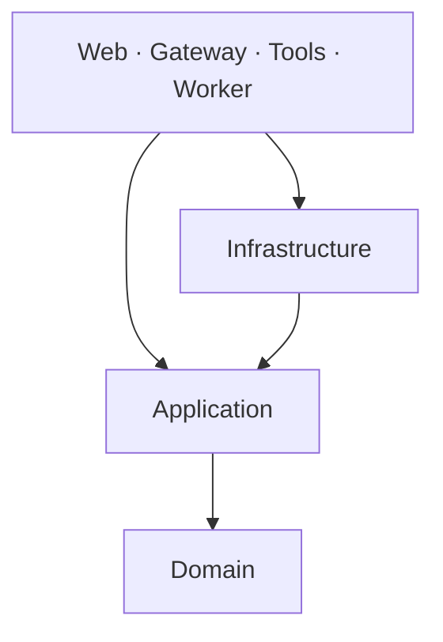

# Architecture

Atlas uses domain driven design within a modular .NET solution. Domain and application code are shared by four small executable hosts. Deployment services remain independently runnable; the relational database is shared in this local deployment.

## Dependency rules



- `Hub.Domain` has no project or package dependencies. It owns business vocabulary, aggregate invariants and authorization expressions.
- `Hub.Application` references Domain and framework abstractions for dependency injection, logging and options. It owns use cases and declares ports for persistence, model inference, speech, vectors, file storage and tools.
- `Hub.Infrastructure` implements those ports. EF Core, provider SDKs, PDF parsing, filesystem access, network clients and schema initialization live here.
- Hosts provide transport, security middleware, scheduling and composition. They do not query EF Core or use database/provider SDKs directly. The model gateway is an HTTP proxy, so upstream response forwarding belongs to that host.
- Cross-layer dependencies use interfaces. Do not add references from Domain or Application to a host or Infrastructure.
- Every declared class, record, interface and enum belongs in its own matching file. Generated build files are excluded.

These rules are checked by `LayerDependencyTests`. Builds treat warnings as errors.

## Source layout

```text
src/
  Hub.Domain/
    Common/          Aggregate marker and domain rule errors
    Identity/        Accounts, roles and email addresses
    Workspace/       Team names and persisted preferences
    Knowledge/       Documents, passages, access policies and indexing states
    Conversations/   Conversation aggregate, messages and voice metadata
    Agents/          Answer runs, events and lifecycle states
    Approvals/       Bound document deletion decisions
    Usage/           Model usage accounting records
    Auditing/        Audit records
  Hub.Application/
    Abstractions/    Ports grouped by persistence, AI, agents, storage,
                     security, tools, speech, ingestion and monitoring
    Identity/        Sign-in, bootstrap, session revocation and team accounts
    Documents/       Upload validation, authorized reads and storage keys
    Conversations/   Chat creation, history, pins, rename, delete and stop
    Approvals/       Administrator review use cases
    Knowledge/       Authorized typed tool dispatch
    Search/          Tokenization, BM25/vector fusion, reranking and citations
    Ingestion/       Seed import orchestration and chunk/embedding processing
    Agents/          Rewrite, evidence, prompt building, tools and answer flow
    Speech/          Conversation ownership and private audio persistence
    Monitoring/     Overview, model roles, metrics and budget accounting
    Configuration/  Validated feature and budget options
    Common/         Shared application errors, serialization and activity source
  Hub.Infrastructure/
    Persistence/
      Configurations/  EF entity mappings
      Repositories/    Atomic chat, approval, indexing and run operations
    Storage/         MinIO, local files, seed files, migration and cleanup
    AI/              Gateway client, provider catalog, Qdrant and PDF/vision extraction
    Speech/          Deepgram adapter
    Security/        Password hashing and internal request credentials
    Events/          Durable event append and best-effort Redis mirror
    Caching/         Redis connection lifecycle
    Monitoring/      Actual dependency health checks
  Hub.Web/
    Endpoints/       Thin endpoints grouped by feature
    Contracts/       HTTP input contracts grouped by feature
    Security/        Current user, cookie validation and authorization policies
    Middleware/      Errors, security headers and API antiforgery
    Workers/         Agent queue scheduler
    Components/      Razor application shell
    wwwroot/         Browser interactions and theme assets
  Hub.Gateway/Proxy/ Model HTTP proxy
  Hub.Tools/Endpoints/ MCP JSON-RPC transport
  Hub.Worker/Workers/ Document scheduler
tests/Hub.Tests/
  Architecture/     Dependency direction and one-type-per-file checks
  Domain/           Aggregate invariants and authorization policy tests
  Application/      Text, vector and rewrite rules
  Integration/      API security, persistence, concurrency and provider workflows
  Support/          Isolated host factory, clients and provider substitutes
```

## Aggregates and business rules

`HubUser` owns lockouts, password initialization, password changes, account enablement and session version increments. Creation validates email, name, team and role. Password hashing remains an infrastructure concern.

`Document` owns identity, ownership, access level, indexing status, retry state and passage counts. Its factory validates metadata. Indexing and deletion guards prevent incompatible actions. The team and access level also determine the storage folder; database authorization still decides whether someone may read a file.

`Conversation` owns its title, user and active run claim. It accepts one active answer and cannot be deleted while that answer is active. Messages, runs, pins and linked voices are committed or removed through the conversation consistency boundary.

`AgentRun` owns the queued/running/terminal lifecycle. A process claims a run with an owner and renewable lease. Terminal persistence is conditional on ownership, preventing a stale runner from completing a recovered answer.

`Approval` binds one requester to one document and one decision. Its decision can be resolved once. Only administrators can resolve requests; both the HTTP policy and application service enforce the role.

Email and team names are validated value objects. Existing persisted status/access strings remain unchanged so existing records, folders, sessions and API clients remain compatible.

## Persistence and transaction ownership

`IHubSessionFactory` opens a short-lived `IHubSession` unit of work. Its deferred LINQ queries are ORM-neutral specifications executed by the adapter; queries must be materialized before disposing the session. This deliberately avoids exposing `DbContext`, `DbSet`, EF async extensions or change tracking to business workflows. Passage queries include their document in the EF adapter so authorization and citation metadata remain available.

Atomic operations have focused ports rather than application-authored SQL:

| Port | Consistency boundary |
|---|---|
| `IConversationStore` | Owner-scoped pins, conditional run claims, chat deletion and linked voice cleanup |
| `IApprovalStore` | Conditional decision, document removal, audit and durable object deletion job |
| `IDocumentIndexStore` | Expiring indexing claims and transactional passage replacement |
| `IRunStore` | Worker claims, renewal, expired-run recovery and idempotent answer completion |

Answer completion commits the assistant message, terminal event, run status and released conversation claim together. Recovery writes durable terminal events before releasing an expired claim. Redis is a best-effort mirror after SQL commit. Provider execution is not exactly once across process failures.

Passage replacement commits all new passages and document metadata in one transaction; failed writes preserve the previous passages. Object deletion uses a persistent outbox stored in Settings, so a temporary MinIO failure cannot lose cleanup work. Existing document ACLs apply before download, image reading, retrieval and tool execution.

The refactor preserves relational table/column names, provider configuration, embedding collection names, object paths and API routes. It does not require resetting the database or reindexing existing knowledge. Schema initialization remains in the web startup composition root. Future schema changes require an explicit migration plan.

## Adding a feature

1. Put invariants and business vocabulary in the relevant Domain feature. Keep I/O out of aggregates.
2. Add a focused application use case and explicit input/output types. Add a port if it needs a new external capability.
3. Implement the adapter under Infrastructure and register it in its composition module. Application registrations live in `Hub.Application.DependencyInjection`.
4. Add thin transport endpoints or a scheduler in the relevant host. Keep transport-specific types out of Application.
5. Add tests for the behavior and any authorization or concurrency boundary. Run the full solution build and test suite before rebuilding containers.

## Verification

```powershell
dotnet build AtlasHub.slnx -c Release
dotnet test AtlasHub.slnx -c Release
dotnet format AtlasHub.slnx --verify-no-changes --no-restore
```

Integration tests use a fresh SQLite database and isolated local storage. Provider workflow tests substitute model and speech ports so tests do not consume external credits. Docker verification additionally exercises PostgreSQL, MinIO, Redis, Qdrant, the internal tool service and the model gateway against the actual deployment.
